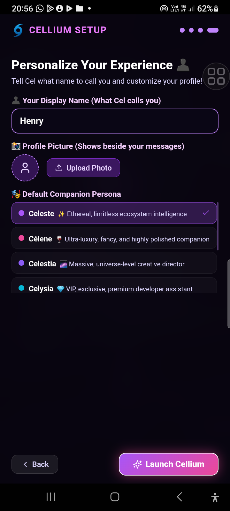
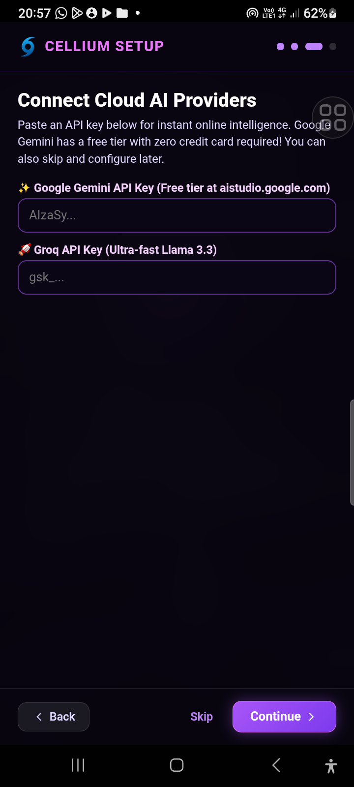
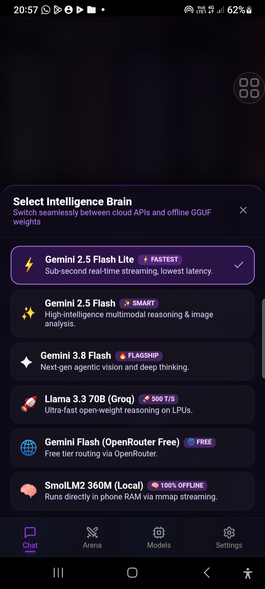
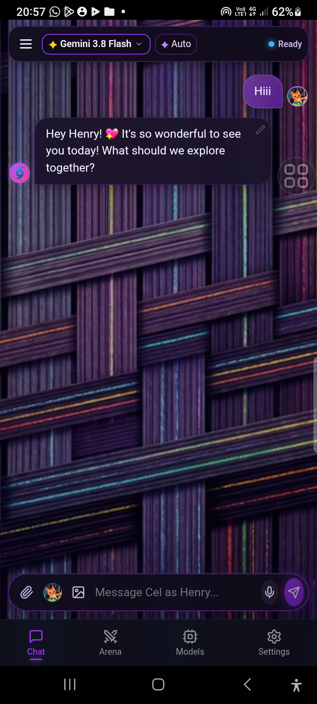
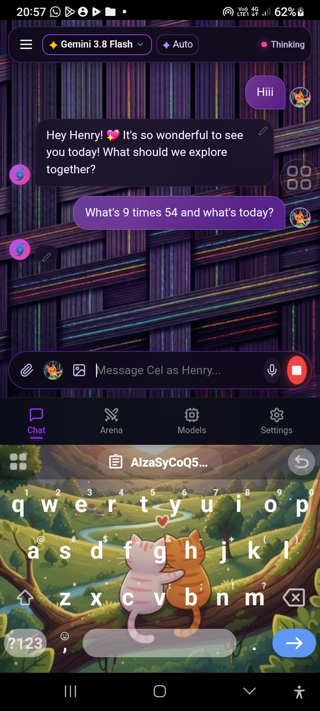

# Android_Bugs - adb forensic report (`Test Android.py`)

> This whole file is **overwritten on every run** - raw dumps (logcat / dumpsys / uiautomator / txt / xml) are deleted after packaging. Only this file + `tests/last_screenshots/` persist.

## Run

| field | value |
|---|---|
| timestamp | 20261106_205643 |
| device | `10.149.194.31:5555` - Android 13 (SDK 33) |
| package | `HenryJayZ.CelSuite.Cellium` - installed v2611.06.11 |
| source | versionName 2611.06.11, versionCode 26110611 |
| launcher | `HenryJayZ.CelSuite.Cellium/.MainActivity` |
| launch method | am start |
| window | 60s, snapshots every 15s |

## Verdict - CLEAN

### Counters

| metric | value |
|---|---|
| log levels | V: 139 D: 145438 I: 137129 W: 219 E: 17075 F: 0 |
| anomaly lines | 0 |
| app E/F lines | 0 |
| patterns | FATAL EXCEPTION=0, ANR in=0, OutOfMemoryError=0, Permission Denial=0, tombstone=0 |

### Top error tags

| tag | E lines |
|---|---|
| `RILD` | 10553 |
| `RILC` | 1890 |
| `RILD2` | 1679 |
| `TelephonyManager` | 1033 |
| `RILJ` | 648 |
| `DCT-C-0` | 449 |
| `CarrierPrivilegesTracker` | 234 |
| `SmsDispatchersController` | 79 |
| `Phone` | 66 |
| `RILClient` | 56 |
| `rild` | 48 |
| `CarrierSignalAgent` | 30 |

### PID timeline

```text
t+0.0  pid=13150 (after launch)
```

### Memory (dumpsys meminfo TOTAL)

```text
t+  15.4s  TOTAL 251218 193080 17016 393 382552 95241 66393 28847
t+  30.2s  TOTAL 326603 266328 17120 242 459580 98467 70444 28022
t+  45.1s  TOTAL 217514 156764 17324 232 352384 95419 61818 33600
```

### Window focus (final)

```text
mCurrentFocus=Window{144cae7 u0 HenryJayZ.CelSuite.Cellium/HenryJayZ.CelSuite.Cellium.MainActivity}
  mFocusedApp=ActivityRecord{2e089bc u0 HenryJayZ.CelSuite.Cellium/.MainActivity} t658}
```

### Battery

```text
level: 62
  temperature: 480
```

### CPU (app rows)

```text
+0% 13150/HenryJayZ.CelSuite.Cellium: 0% user + 0% kernel
```

### Activity (resumed)

```text
ACTIVITY com.alphainventor.filemanager/.activity.MainActivity 74bf08f pid=13840
  ACTIVITY com.airtel.africa.selfcare/.dashboard.presentation.activities.HomeActivity d9424f0 pid=15952
  ACTIVITY com.whatsapp/.home.ui.HomeActivity 31466e8 pid=(not running)
  ACTIVITY com.discord/.main.MainDefault 241210b pid=5519
  ACTIVITY com.microsoft.xboxone.smartglass.beta/com.microsoft.xbox.MainActivity fd88dcc pid=6125
  ACTIVITY com.sec.android.app.launcher/com.android.quickstep.RecentsActivity d9ac53a pid=20311
  ACTIVITY com.teslacoilsw.launcher/.NovaLauncher 22b22a5 pid=1667
  ACTIVITY HenryJayZ.CelSuite.Cellium/.MainActivity 2e089bc pid=13150
```

### Processes (app rows)

```text
*APP* UID 10672 ProcessRecord{ee61c0 13150:HenryJayZ.CelSuite.Cellium/u0a672}
    dir=/data/app/~~dt6McfOVPpXg8VubPxppEg==/HenryJayZ.CelSuite.Cellium-3WQ84rd_Ime-g9kWInqxzg==/base.apk publicDir=/data/app/~~dt6McfOVPpXg8VubPxppEg==/HenryJayZ.CelSuite.Cellium-3WQ84rd_Ime-g9kWInqxzg==/base.apk data=/data/user/0/HenryJayZ.CelSuite.Cellium
    packageList={HenryJayZ.CelSuite.Cellium}
      - ServiceRecord{b364ef3 u0 HenryJayZ.CelSuite.Cellium/.service.CelliumForegroundService}
      - ConnectionRecord{92e83 u0 CR IMP HenryJayZ.CelSuite.Cellium/org.chromium.content.app.SandboxedProcessService0:0:@4744132}
      - ConnectionRecord{d176312 u0 CR WPRI HenryJayZ.CelSuite.Cellium/org.chromium.content.app.SandboxedProcessService0:0:@2a5429d}
        -> ContentProviderRecord{8b22bec u0 HenryJayZ.CelSuite.Cellium/androidx.startup.InitializationProvider}
      - 86c626c/com.android.providers.settings/.SettingsProvider->13150:HenryJayZ.CelSuite.Cellium/u0a672 s1/1 u0/0 +1m2s990ms
      - ReceiverList{28b2ad0 13150 HenryJayZ.CelSuite.Cellium/10672/u0 remote:dfc7a93}
      - ReceiverList{2aeedf6 13150 HenryJayZ.CelSuite.Cellium/10672/u0 remote:ab25a91}
      - ReceiverList{4910ecd 13150 HenryJayZ.CelSuite.Cellium/10672/u0 remote:a6dac64}
      - ReceiverList{5ecc35b 13150 HenryJayZ.CelSuite.Cellium/10672/u0 remote:f8426a}
      - ReceiverList{652842c 13150 HenryJayZ.CelSuite.Cellium/10672/u0 remote:6262fdf}
      - ReceiverList{a7ab4c2 13150 HenryJayZ.CelSuite.Cellium/10672/u0 remote:f010d0d}
      - ReceiverList{ba4b6ba 13150 HenryJayZ.CelSuite.Cellium/10672/u0 remote:9a7be5}
      - ReceiverList{e2a3a37 13150 HenryJayZ.CelSuite.Cellium/10672/u0 remote:a501b36}
      - ActivityRecord{2e089bc u0 HenryJayZ.CelSuite.Cellium/.MainActivity} t658}
      - Task{5b799cb #658 type=standard A=10672:HenryJayZ.CelSuite.Cellium U=0 visible=true visibleRequested=true mode=fullscreen translucent=false sz=1}
    packageList={HenryJayZ.CelSuite.Cellium}
      - ServiceRecord{d849e5e u0 HenryJayZ.CelSuite.Cellium/org.chromium.content.app.SandboxedProcessService0:0}
    Proc # 1: fg     T/A/TOP  LCMN  t: 0 13150:HenryJayZ.CelSuite.Cellium/u0a672 (top-activity)
        HenryJayZ.CelSuite.Cellium/org.chromium.content.app.SandboxedProcessService0:0<=Proc{13150:HenryJayZ.CelSuite.Cellium/u0a672}
      proc=ProcessRecord{ee61c0 13150:HenryJayZ.CelSuite.Cellium/u0a672}
    #41: fg     TOP  LCMN 13150:HenryJayZ.CelSuite.Cellium/u0a672 act:activities|recents
    Proc # 1: fg     T/A/TOP  LCMN  t: 0 13150:HenryJayZ.CelSuite.Cellium/u0a672 (top-activity)
        HenryJayZ.CelSuite.Cellium/org.chromium.content.app.SandboxedProcessService0:0<=Proc{13150:HenryJayZ.CelSuite.Cellium/u0a672}
    PID #13150: ProcessRecord{ee61c0 13150:HenryJayZ.CelSuite.Cellium/u0a672}
```

### Anomalies (0 lines, first 0 shown)

```text
```

### Screenshots (latest run)







---
*Generated by `Test Android.py` - adb only, device-IP independent. Exit codes: 0 clean · 1 warnings · 2 ANR/died · 3 crash.*
